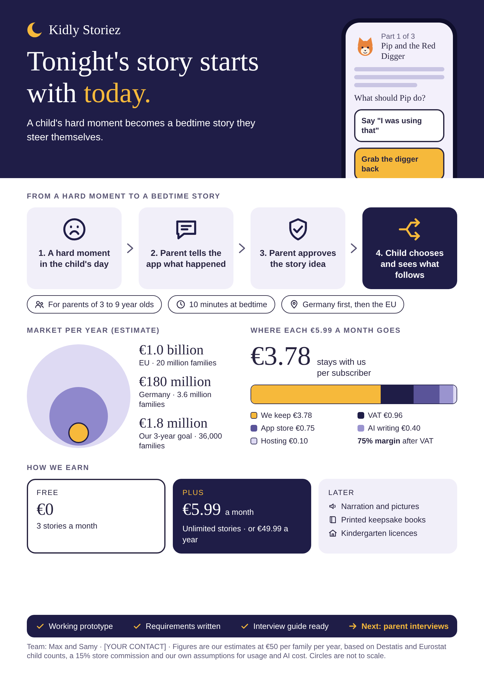

# Pitch one-pager

One A4 page for pitching Kidly Storiez to the hackathon jury.

## Files

- `one-pager.html`: the page itself. Open it in a browser; it loads its fonts from Google Fonts. Print it to PDF from the browser for the best result.
- `one-pager.pdf` and `one-pager.png`: exports for quick viewing. They were made without access to the web fonts, so the typefaces differ slightly from the HTML.

The contact in the footer is still a placeholder.

## Where the numbers come from

All figures are estimates for the pitch, not forecasts. The price is a proposal: open question 5 in `docs/REQUIREMENTS.md` is still undecided.

| Figure | Basis |
| --- | --- |
| EU market, €1.0 billion a year | About 30 million children aged 3 to 9, derived from Eurostat (450.6 million people, 14.4% aged 0 to 14, January 2025). Assumes even age groups and 1.5 children in that range per family, so about 20 million families at €50 a year. |
| Germany, €180 million a year | About 5.4 million children aged 3 to 9, derived from Destatis (10.8 million children under 14, end of 2025). About 3.6 million families at €50 a year. |
| Three-year goal, €1.8 million a year | 1% of those German families, which is 36,000 subscribers. The 1% is our assumption. |
| €3.78 kept from €5.99 a month | Less 19% German VAT (€0.96), 15% store commission under Apple's Small Business Program (€0.75), AI writing for 20 stories at about €0.02 each (€0.40) and hosting (€0.10). Stories per month and AI cost are our assumptions. |
| 75% margin after VAT | €3.78 of €5.03 net revenue. |
